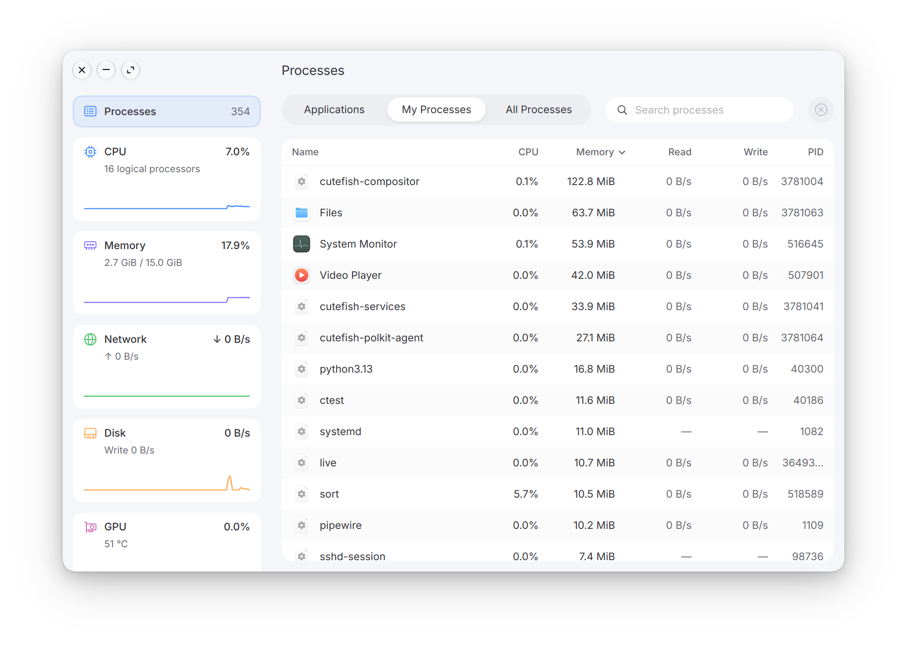

# System Monitor

The system monitor of Cutefish Desktop. It shows CPU, memory, disk, network
and GPU usage, and lists the running processes so they can be stopped.



## Dependencies

System Monitor uses cutefish-toolkit and ICU; GoogleTest for the tests.

```sh
sudo apt install cmake pkg-config libicu-dev libgtest-dev
```

## Build and install

```sh
mkdir build
cd build
cmake -DCMAKE_INSTALL_PREFIX=/usr ..
make
sudo make install
```

## Tests

```sh
cmake -DBUILD_TESTING=ON ..
make
dbus-run-session -- ctest --output-on-failure
```

## Open-source references

`src/nvmlreader.cpp` reads NVIDIA cards through the driver's
`libnvidia-ml.so.1` the way [Resources](https://gitlab.gnome.org/GNOME/Incubator/resources)
(GPL-3.0) does: the library opened at run time, each card found by its PCI
address, and the same NVML queries for activity, video encoder and decoder,
video memory, temperature, clocks and power. Only the behaviour was followed;
no code was taken over.

## License

BSD-3-Clause; see [LICENSE](LICENSE).
